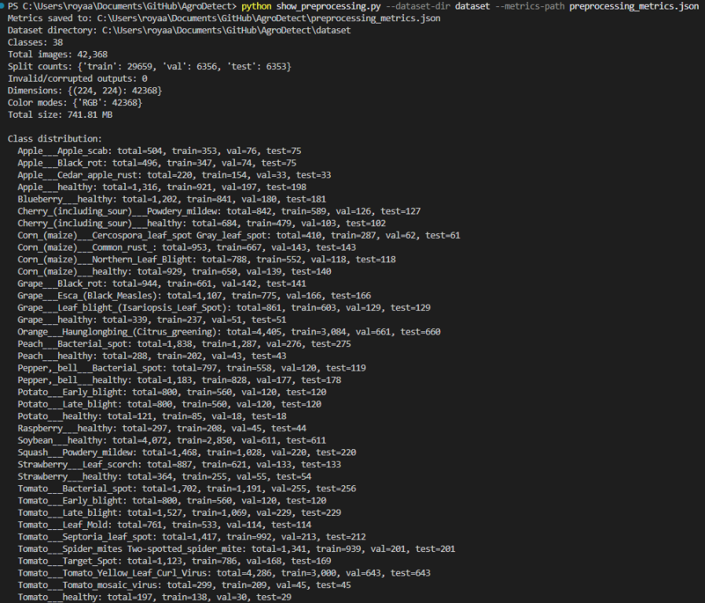

# AgroDetect

AgroDetect is a crop disease image-classification project built around the
PlantVillage dataset. The work completed so far establishes the data pipeline
needed for future model training and evaluation.

## Work completed

### Dataset preprocessing

`preprocess_dataset.py` implements the dataset preparation workflow:

- Validates that the input contains all 38 expected plant-health classes.
- Supports both a class-folder dataset root and a PlantVillage directory
  containing a `train` subdirectory.
- Detects and skips corrupted images while reporting warnings.
- Creates reproducible stratified train, validation, and test splits using a
  70/15/15 ratio.
- Resizes images to `224x224`, converts them to RGB, and stores them as
  optimized JPEG files.
- Generates the class-to-index mapping and project configuration.

### PyTorch data loading

`dataset_loader.py` provides `get_dataloaders`, which creates train,
validation, and test `DataLoader` instances from the prepared directory
structure.

Training images receive random horizontal flips, rotations, and color jitter.
Validation and test images use deterministic resizing. All splits are
converted to tensors and normalized with ImageNet mean and standard deviation
values.

### Dataset metadata

- `config.py` stores the 38 class names, image size, batch size, and dataset
  paths.
- `class_indices.json` stores the numeric label assigned to each class.
- The generated dataset is organized into `train`, `val`, and `test`
  directories with one subdirectory per class.

### Preprocessing metrics

The terminal output from `show_preprocessing.py` is shown below:

## Current project status

The repository currently contains the dataset preparation and loading stages
of the project. Model architecture, training, evaluation, and inference
components are provided in `vgg16_training.ipynb`. The notebook trains a
two-phase VGG16 model locally and writes checkpoints, weights, metrics, and
plots to the `vgg16` directory.

## Project files

| File | Purpose |
| --- | --- |
| `preprocess_dataset.py` | Validates, splits, resizes, and exports the dataset |
| `dataset_loader.py` | Defines preprocessing and PyTorch data loaders |
| `show_preprocessing.py` | Displays and saves preprocessing metrics |
| `config.py` | Defines dataset configuration and class metadata |
| `class_indices.json` | Maps class names to numeric labels |
| `vgg16_training.ipynb` | Local, checkpointed two-phase VGG16 training and evaluation |
| `train_vgg16.py` | Standalone VGG16 training and evaluation script |
